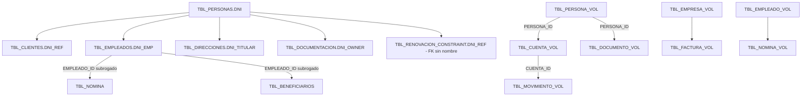

# DM_DUMMY: esquema de prueba del motor de enmascaramiento

> [!info] Para que sirve
> DM_DUMMY es un esquema sintetico con datos personales falsos pero con formato y digito de control reales (NIF, NIE, CIF, IBAN). Cada columna esta puesta ahi por una razon concreta: unas **deben** enmascararse, otras parecen datos personales y **no deben**, y otras ejercitan una situacion dificil (FK en cadena, trigger de UPDATE, volumen, corte de sesion). Este documento dice cual es cual, para que una corrida del motor se pueda dar por buena o por mala sin interpretar nada.

## 1. Archivos y ejecucion

Solo hay dos archivos. Sustituyen a `01_poc_esquema_dummy_ddl.sql`, `03_poc_esquema_dummy_cierre_ddl.sql` y `poc_esquema_dummy_volumen_dml.sql`, que se pueden borrar.

| Orden | Archivo | Que hace |
|---|---|---|
| 1 | `dm_dummy_01_ddl.sql` | Comprueba que existe el tablespace `DM_DUMMY` (y el esquema del motor) **antes de tocar nada**; recrea el usuario, las 35 tablas, 12 FK, 3 indices de apoyo, 2 indices unicos y el trigger; concede `SELECT, UPDATE` al esquema del motor. |
| 2 | `dm_dummy_02_dml.sql <millones>` | Vacia las 35 tablas y las carga; ademas escribe en el esquema del motor las excepciones, las reglas especiales y la relacion de sincronizacion de la prueba. El parametro son los millones de filas de las 12 tablas de volumen, de 0.5 a 60. |

```
@dm_dummy_01_ddl
@dm_dummy_02_dml 2
```

Ambos se ejecutan como DBA. El DDL no admite argumentos. El DML sin argumento carga 2.

> [!tip] Repetir con otro volumen
> No hace falta rehacer el DDL: `@dm_dummy_02_dml 10` vacia y recarga. Rehacer el DDL solo hace falta para volver al esquema original (por ejemplo tras una prueba que dejo constraints cambiadas).

> [!warning] Efecto sobre el catalogo del motor
> Recargar DM_DUMMY **no** toca las tablas `TDM_*` del motor. Tras recargar, el catalogo (`TDM_COLUMNA_FINAL`) y las marcas de "ya enmascarado" (`TDM_MASK_TRACE`) describen datos que ya no existen. Haz un descubrimiento nuevo (`@dm_descubre DM_DUMMY Y`) antes de enmascarar, o el motor saltara columnas que cree hechas.

### Guardas del DDL

| Comprobacion | Si falla |
|---|---|
| Existe el tablespace `DM_DUMMY`, es `PERMANENT` y esta `ONLINE` | ORA-20001 / ORA-20002, no se ha tocado nada |
| Existe `ASTSYSADMIN` o `ACC_ADMIN` | ORA-20003, no se ha tocado nada |
| Al final: 35 tablas, 12 FK, 1 trigger activo, 0 objetos invalidos | ORA-20004 |

El esquema del motor se busca con la misma regla que el resto del proyecto: `ASTSYSADMIN` primero y, si no existe, `ACC_ADMIN`. Los grants salen de `DBA_TABLES` en un bucle, sin una linea por tabla ni variables de sustitucion de SQL*Plus.

La cuenta `DM_DUMMY` se crea **bloqueada**: es un contenedor de datos y nada se conecta como ella. Si una prueba lo necesita, `alter user DM_DUMMY account unlock;`.

### Guardas del DML

| Comprobacion | Si falla |
|---|---|
| Parametro numerico (acepta `0.5` y `0,5`) | ORA-20401 |
| Entre 0.5 y 60 | ORA-20402 |
| Las 35 tablas existen | ORA-20403 (ejecuta antes el DDL) |
| Espacio del tablespace (aviso, no aborta) | Mensaje `AVISO` si parece corto |

Durante una carga larga, desde otra sesion:

```sql
select target_desc, sofar, totalwork, round(sofar/totalwork*100,1) pct
  from v$session_longops where opname = 'DM_DUMMY carga' order by start_time desc;
```

## 2. Volumen

El parametro `M` reparte 60 M de filas base entre las 12 tablas de volumen en proporcion fija (`escala = M/60`, con un minimo por tabla). Las tablas de correctitud y de cierre **no escalan**, porque las pruebas dependen de su tamano.

| Tabla | 60 M | 10 M | 2 M | 0.5 M | Papel |
|---|---:|---:|---:|---:|---|
| `TBL_PERSONA_VOL` | 5.000.000 | 833.333 | 166.667 | 41.667 | raiz de identidad |
| `TBL_CUENTA_VOL` | 18.000.000 | 3.000.000 | 600.000 | 150.000 | primer salto FK |
| `TBL_MOVIMIENTO_VOL` | 26.900.000 | 4.483.333 | 896.667 | 224.167 | segundo salto FK, la mayor |
| `TBL_EMPRESA_VOL` | 150.000 | 25.000 | 5.000 | 1.250 | identidad CIF |
| `TBL_FACTURA_VOL` | 3.000.000 | 500.000 | 100.000 | 25.000 | hija de empresa |
| `TBL_EMPLEADO_VOL` | 300.000 | 50.000 | 10.000 | 2.500 | tabla ancha, 25 columnas |
| `TBL_NOMINA_VOL` | 4.000.000 | 666.667 | 133.333 | 33.333 | hija de empleado |
| `TBL_DOCUMENTO_VOL` | 800.000 | 133.333 | 26.667 | 6.667 | hija de persona |
| `TBL_AUDIT_LOG_VOL` | 1.500.000 | 250.000 | 50.000 | 12.500 | sin FK |
| `TBL_REFERENCIA_PUBLICA_VOL` | 50.000 | 8.333 | 1.667 | 417 | no personal |
| `TBL_REFERENCIA_INVERSA_VOL` | 100.000 | 16.667 | 3.333 | 833 | FORCE |
| `TBL_CONFIG_TECNICA_VOL` | 200.000 | 33.333 | 6.667 | 1.667 | control negativo |
| **Total volumen** | **60.000.000** | **9.999.999** | **2.000.001** | **500.001** | |

Filas fijas ademas del volumen: 1.100 de correctitud (10 x 110), 150.000 en `TBL_SUCURSAL_RIESGO`, 150.000 en `TBL_LOTE_RESUME`, 1.000 en `TBL_GESTOR_CARTERA`, 50 en `TBL_RESUMEN_SUCURSAL` y 50 en `TBL_RENOVACION_CONSTRAINT`.

> [!note] Que ruta toma el motor segun el volumen
> `proc_dm_ejecuta_update_seguro` decide por `NUM_ROWS` de `DBA_TABLES`: hasta 100.000 filas, un UPDATE directo; por encima, `DBMS_PARALLEL_EXECUTE` por bloques (chunks de 2.000 bloques hasta 1 M de filas, 8.000 hasta 10 M, 20.000 por encima). Por eso el DML termina con `DBMS_STATS`: sin estadisticas la decision se toma con un `COUNT(*)` de reserva. A 0.5 M ya hay tablas por encima del umbral (cuenta, movimiento, y las dos de 150.000 filas del cierre); `TBL_PERSONA_VOL` lo cruza a partir de ~1.2 M.
>
> Espacio orientativo: ~130 MB por millon de filas entre tablas e indices (~8 GB a 60 M). Mide el tuyo con `DBA_SEGMENTS`.

## 3. Como esta construido (propiedades que importan para las pruebas)

- **Identificadores = indice del bucle** (rango contiguo 1..N, sin secuencias). Cada tabla hija recalcula el valor del padre con la misma formula, sin consultarlo. Por eso las FK y las relaciones logicas son correctas por construccion, a cualquier volumen.
- **Valores con digito de control real**: NIF (letra mod 23), NIE (prefijo X/Y/Z = 0/1/2 y mod 23), CIF (digito de control), IBAN (mod 97). Se han comprobado con un calculo independiente. Los patrones del descubrimiento validan ese digito, asi que un valor inventado no puntuaria.
- **Rangos numericos separados por dominio** para que dos personas distintas nunca compartan valor: personas 3.0e7, referencias publicas 6.0e7, empleados 8.0e7, etc. Si dos columnas con el mismo identificador muestran el mismo valor enmascarado, es porque comparten valor original.
- **FK deshabilitadas durante la carga** y validadas al final con `ENABLE VALIDATE`: si hubiera un huerfano, el DML fallaria. Los tres indices de apoyo a FK se marcan `UNUSABLE` y se reconstruyen una vez, mucho mas barato que mantenerlos fila a fila.
- **Sin caracteres no ASCII** (`ESPANA`, `MANANA`, `PISO`): el contenido no depende de la codificacion del cliente.
- **Sin secuencias.** Lo unico que el DML escribe fuera de `DM_DUMMY` son las 5 excepciones de prueba en `TDM_EXCEPCION_COL` del esquema del motor (seccion 7).

## 4. Dominios y propagacion

El ajuste (tweak) de FF1 depende **solo del identificador**, no de la tabla (`func_dm_ajuste_dominio`). Mismo identificador y mismo valor original dan el mismo valor enmascarado en cualquier tabla, y las FK se mantienen. El descubrimiento ademas propaga por FK el identificador de mayor prioridad a toda la cadena (`proc_dm_propaga_dominios`).



Tres situaciones distintas:

1. **Columna de FK que es dato personal** (`DNI_REF`, `DNI_EMP`, `DNI_TITULAR`, `DNI_OWNER`, `TBL_RENOVACION_CONSTRAINT.DNI_REF`): se enmascara igual que el padre. Hijo sin padre = fallo grave.
2. **Columna de FK que es id subrogado** (`EMPLEADO_ID`, `PERSONA_ID`, `CUENTA_ID`, `EMPRESA_ID`): **no se enmascara**. Es la columna que enlaza, no un dato personal.
3. **Relacion logica sin FK** (`TBL_AUDIT_LOG.DNI_USUARIO`, `TBL_HISTORIAL_CONTACTO.*`, `TBL_AUDIT_LOG_VOL.NIF_USUARIO`): se descubren por nombre y dato. Por determinismo del tweak por identificador deben coincidir con el padre; la seccion 6 lo comprueba. Si no coinciden, es un hallazgo y la herramienta prevista es `TDM_MASK_RELACION_SYNC`.

Sin relacion con el resto, a proposito: `TBL_EMPLEADO_VOL` (mismo tipo de dato que `TBL_PERSONA_VOL` pero rango de valores distinto), `TBL_BENEFICIARIOS` (terceros) y `TBL_NOMINA.IBAN_ABONO` (rango de banco propio).

## 5. Matriz de columnas

Clases:

- **MASK**: dato personal real. Debe quedar `enmascarar = Y`.
- **NO**: no debe quedar en `Y`. Incluye los **senuelos** (el nombre o el aspecto engana, el dato lo desmiente), los ids subrogados, fechas, importes, enumerados y textos sin datos personales.
- **FORCE**: dato real que el nombre no delata. Entra con una excepcion `FORCE` (seccion 7); el dato por si solo puede o no bastar.
- **EXCL**: dato personal real que una excepcion `EXCLUDE` saca del enmascarado (seccion 7). Debe quedar fuera de `Y` y con el valor intacto tras enmascarar.
- **LIM**: caso limite, texto libre con datos personales en una fraccion de filas. Puede salir `Y` o `REVISAR`; no se exige ninguno.

| Bloque | Tablas | Columnas | MASK | FORCE | EXCL | LIM | NO |
|---|---|---|---|---|---|---|---|
| Correctitud | 10 | 63 | 24 | 1 | 1 | 0 | 37 |
| Volumen | 12 | 105 | 23 | 1 | 0 | 2 | 79 |
| Cierre | 5 | 17 | 3 | 2 | 0 | 0 | 12 |
| Casos especiales | 8 | 27 | 9 | 3 | 0 | 0 | 15 |
| **Total** | 35 | 212 | 59 | 7 | 1 | 2 | 143 |

El identificador esperado es el que usa el motor en `TDM_COLUMNA_FINAL.IDENTIFICADOR`. `TDM_COLUMNA_HIST` solo guarda las columnas con alguna evidencia, asi que contara menos de 185 (la corrida anterior registro 68 sobre 22 tablas).

### Correctitud (10 tablas, 110 filas cada una)

#### `TBL_PERSONAS`

| Columna | Tipo | Clase | Identificador esperado | Por que |
|---|---|---|---|---|
| `DNI` | VARCHAR2(20) | **MASK** | IDENTIFICADOR_IDENTIDAD | Raiz del dominio de identidad; PK referenciada por 5 FK. |
| `NOMBRE` | VARCHAR2(100) | **MASK** | IDENTIFICADOR_PERSONAL | Nombre de pila, solo letras. |
| `APELLIDOS` | VARCHAR2(150) | **MASK** | IDENTIFICADOR_PERSONAL | Dos apellidos. |
| `DIRECCION` | VARCHAR2(200) | **MASK** | IDENTIFICADOR_DIRECCION | Via + numero + CP + localidad. |
| `FECHA_NACIMIENTO` | DATE | **NO** | - | Fecha: ningun identificador la cubre. |
| `TELEFONO` | VARCHAR2(20) | **MASK** | IDENTIFICADOR_TELEFONO | 9 digitos que empiezan por 6. |
| `EMAIL` | VARCHAR2(150) | **MASK** | IDENTIFICADOR_EMAIL | Correo valido, unico por fila. |
| `IBAN` | VARCHAR2(30) | **MASK** | IDENTIFICADOR_BANCARIO | IBAN ES con digito de control mod-97 valido. |
| `CUENTA_CCC` | VARCHAR2(30) | **MASK** | IDENTIFICADOR_BANCARIO | 20 digitos. |
| `NIE_CIF` | VARCHAR2(20) | **MASK** | IDENTIFICADOR_IDENTIDAD | Mezcla: 2/3 NIE (X, Y, Z) y 1/3 CIF; letra o digito de control validos. |
| `DOC_MIXTO` | VARCHAR2(20) | **MASK** | IDENTIFICADOR_IDENTIDAD | DNI, NIE y CIF alternados fila a fila. Solo lo delata el dato (el nombre es debil). |
| `COD_DNI_FALSO` | VARCHAR2(20) | **NO** | - | Senuelo: el nombre dice DNI, el dato es un correlativo de 8 digitos sin letra. |
| `CORREO_INTERNO` | VARCHAR2(50) | **NO** | - | Senuelo: el nombre dice correo, el dato no lleva arroba. |
| `TELEFONO_FICTICIO` | VARCHAR2(20) | **NO** | - | Senuelo: el nombre dice telefono, el dato es EXT-0001. |
| `REFERENCIA_CLIENTE` | VARCHAR2(20) | **FORCE** | IDENTIFICADOR_IDENTIDAD | Nombre neutro; el valor es un DNI real. El dato puede bastar para detectarla; con FORCE es seguro. |
| `USUARIO_AD` | VARCHAR2(50) | **NO** | - | Login tecnico derivado del nombre, no es dato personal por si mismo. |

#### `TBL_CLIENTES`

| Columna | Tipo | Clase | Identificador esperado | Por que |
|---|---|---|---|---|
| `CLIENTE_ID` | NUMBER | **NO** | - | Clave subrogada. |
| `DNI_REF` | VARCHAR2(20) | **MASK** | IDENTIFICADOR_IDENTIDAD | Por FK a personas.dni: hereda el dominio. |
| `TIPO_CLIENTE` | VARCHAR2(50) | **NO** | - | Enumerado. |
| `FECHA_ALTA` | DATE | **NO** | - | Fecha. |
| `SCORE_RIESGO` | NUMBER(5,2) | **NO** | - | Metrica. |

#### `TBL_EMPLEADOS`

| Columna | Tipo | Clase | Identificador esperado | Por que |
|---|---|---|---|---|
| `EMPLEADO_ID` | NUMBER | **NO** | - | Clave subrogada; ancla de nomina y beneficiarios. |
| `DNI_EMP` | VARCHAR2(20) | **MASK** | IDENTIFICADOR_IDENTIDAD | Por FK a personas.dni. |
| `CARGO` | VARCHAR2(100) | **NO** | - | Texto de negocio. |
| `SALARIO` | NUMBER(10,2) | **NO** | - | Importe. |
| `USUARIO_AD` | VARCHAR2(50) | **NO** | - | Mismo senuelo que en personas (comprueba consistencia). |

#### `TBL_DIRECCIONES`

| Columna | Tipo | Clase | Identificador esperado | Por que |
|---|---|---|---|---|
| `DIRECCION_ID` | NUMBER | **NO** | - | Clave subrogada. |
| `DNI_TITULAR` | VARCHAR2(20) | **MASK** | IDENTIFICADOR_IDENTIDAD | Por FK a personas.dni. |
| `CALLE_COMPLETA` | VARCHAR2(200) | **MASK** | IDENTIFICADOR_DIRECCION | Direccion. |
| `CODIGO_POSTAL` | VARCHAR2(10) | **NO** | - | Numerico pero no identifica a nadie. |
| `TIPO_VIVIENDA` | VARCHAR2(30) | **NO** | - | Enumerado. |

#### `TBL_NOMINA`

| Columna | Tipo | Clase | Identificador esperado | Por que |
|---|---|---|---|---|
| `NOMINA_ID` | NUMBER | **NO** | - | Clave subrogada. |
| `EMPLEADO_ID` | NUMBER | **NO** | - | FK a empleados (id subrogado, no personal). |
| `CONCEPTO` | VARCHAR2(100) | **NO** | - | Texto de negocio. |
| `IMPORTE` | NUMBER(10,2) | **NO** | - | Importe. |
| `IBAN_ABONO` | VARCHAR2(30) | **MASK** | IDENTIFICADOR_BANCARIO | IBAN sin FK, rango propio (banco 0182). |
| `FECHA_PAGO` | DATE | **NO** | - | Fecha. |

#### `TBL_BENEFICIARIOS`

| Columna | Tipo | Clase | Identificador esperado | Por que |
|---|---|---|---|---|
| `BENEFICIARIO_ID` | NUMBER | **NO** | - | Clave subrogada. |
| `EMPLEADO_ID` | NUMBER | **NO** | - | FK a empleados. |
| `DNI_BENEFICIARIO` | VARCHAR2(20) | **MASK** | IDENTIFICADOR_IDENTIDAD | Tercero ajeno a personas: sin FK. |
| `EMAIL_BENEFICIARIO` | VARCHAR2(150) | **EXCL** | - | Tercero: sin FK. Es un correo real; la excepcion EXCLUDE lo saca del enmascarado. |
| `PARENTESCO` | VARCHAR2(30) | **NO** | - | Enumerado. |

#### `TBL_AUDIT_LOG`

| Columna | Tipo | Clase | Identificador esperado | Por que |
|---|---|---|---|---|
| `LOG_ID` | NUMBER | **NO** | - | Clave subrogada. |
| `DNI_USUARIO` | VARCHAR2(20) | **MASK** | IDENTIFICADOR_IDENTIDAD | Sin FK: relacion logica con personas.dni (mismos valores). |
| `ACCION` | VARCHAR2(250) | **NO** | - | Texto tecnico. |
| `FECHA_ACCION` | TIMESTAMP | **NO** | - | Marca de tiempo. |
| `IP_ORIGEN` | VARCHAR2(45) | **NO** | - | Tecnico. |
| `USUARIO_SISTEMA` | VARCHAR2(50) | **NO** | - | Cuenta de servicio. |

#### `TBL_HISTORIAL_CONTACTO`

| Columna | Tipo | Clase | Identificador esperado | Por que |
|---|---|---|---|---|
| `HIST_ID` | NUMBER | **NO** | - | Clave subrogada. |
| `DNI_REFERENCIA` | VARCHAR2(20) | **MASK** | IDENTIFICADOR_IDENTIDAD | Sin FK: clave de union logica con personas.dni. |
| `EMAIL_CONTACTO` | VARCHAR2(150) | **MASK** | IDENTIFICADOR_EMAIL | Sin FK: mismo valor que personas.email de esa persona. |
| `TELEFONO_CONTACTO` | VARCHAR2(20) | **MASK** | IDENTIFICADOR_TELEFONO | Sin FK: mismo valor que personas.telefono. |
| `CANAL_CONTACTO` | VARCHAR2(20) | **NO** | - | Enumerado. |
| `NOTES` | VARCHAR2(4000) | **MASK** | IDENTIFICADOR_OBS | Texto libre; en las filas pares lleva nombre, DNI y telefono incrustados. Nombre en ingles: entra por la regla NOTE(S). |

#### `TBL_DOCUMENTACION`

| Columna | Tipo | Clase | Identificador esperado | Por que |
|---|---|---|---|---|
| `DOC_ID` | NUMBER | **NO** | - | Clave subrogada. |
| `DNI_OWNER` | VARCHAR2(20) | **MASK** | IDENTIFICADOR_IDENTIDAD | Por FK a personas.dni. |
| `NOMBRE_ARCHIVO` | VARCHAR2(250) | **NO** | - | Nombre de fichero. |
| `OBSERVACIONES` | VARCHAR2(4000) | **MASK** | IDENTIFICADOR_OBS | Texto con nombre, DNI y correo incrustados en todas las filas. |
| `DATOS_CRUDOS` | VARCHAR2(4000) | **MASK** | IDENTIFICADOR_OBS | JSON como texto con dni, email e iban. Solo lo delata el dato. |
| `NUM_PAGINAS` | NUMBER | **NO** | - | Contador. |

#### `TBL_REFERENCIAS_PUBLICAS`

| Columna | Tipo | Clase | Identificador esperado | Por que |
|---|---|---|---|---|
| `REF_ID` | NUMBER | **NO** | - | Clave subrogada. |
| `DNI_PUBLICO` | VARCHAR2(20) | **NO** | - | DNI VALIDO de un dataset publico. Lo descarta la regla de nombre de tabla REFERENCIAS_PUBLICAS (-300); no necesita EXCLUDE. |
| `DESCRIPCION` | VARCHAR2(200) | **NO** | - | Texto. |

### Volumen (12 tablas, escalan de 0.5 a 60 M)

#### `TBL_PERSONA_VOL`

| Columna | Tipo | Clase | Identificador esperado | Por que |
|---|---|---|---|---|
| `PERSONA_ID` | NUMBER | **NO** | - | Clave subrogada; FK de cuenta_vol y documento_vol. |
| `NIF` | VARCHAR2(20) | **MASK** | IDENTIFICADOR_IDENTIDAD | NIF con letra valida. |
| `NOMBRE` | VARCHAR2(100) | **MASK** | IDENTIFICADOR_PERSONAL | JUAN_n, MARIA_n... |
| `APELLIDOS` | VARCHAR2(150) | **MASK** | IDENTIFICADOR_PERSONAL | Dos apellidos. |
| `DIRECCION` | VARCHAR2(200) | **MASK** | IDENTIFICADOR_DIRECCION | Direccion. |
| `TELEFONO` | VARCHAR2(20) | **MASK** | IDENTIFICADOR_TELEFONO | 9 digitos que empiezan por 6. |
| `EMAIL` | VARCHAR2(150) | **MASK** | IDENTIFICADOR_EMAIL | Correo. |
| `OBSERVACIONES` | VARCHAR2(500) | **MASK** | IDENTIFICADOR_OBS | Datos personales incrustados en 1 de cada 20 filas. |
| `FECHA_NACIMIENTO` | DATE | **NO** | - | Fecha. |
| `FECHA_ALTA` | DATE | **NO** | - | Fecha. |
| `PROFESION` | VARCHAR2(80) | **NO** | - | Texto de negocio. |
| `ESTADO_CIVIL` | VARCHAR2(20) | **NO** | - | Enumerado. |
| `PAIS_RESIDENCIA` | VARCHAR2(60) | **NO** | - | Constante. |
| `TIPO_PERSONA` | VARCHAR2(20) | **NO** | - | Enumerado. |
| `CANAL_CAPTACION` | VARCHAR2(30) | **NO** | - | Enumerado. |
| `SCORE_RIESGO` | NUMBER(5,2) | **NO** | - | Metrica. |
| `ACTIVO` | CHAR(1) | **NO** | - | Indicador. |
| `NIF_FALSO_DECOY` | VARCHAR2(20) | **NO** | - | Senuelo: correlativo de 8 digitos sin letra. |

#### `TBL_CUENTA_VOL`

| Columna | Tipo | Clase | Identificador esperado | Por que |
|---|---|---|---|---|
| `CUENTA_ID` | NUMBER | **NO** | - | Clave subrogada; FK de movimiento_vol. |
| `PERSONA_ID` | NUMBER | **NO** | - | FK a persona_vol (id subrogado). |
| `IBAN` | VARCHAR2(30) | **MASK** | IDENTIFICADOR_BANCARIO | Dos bancos alternados. |
| `CUENTA_CCC` | VARCHAR2(30) | **MASK** | IDENTIFICADOR_BANCARIO | 20 digitos. |
| `SALDO` | NUMBER(14,2) | **NO** | - | Importe. |
| `FECHA_APERTURA` | DATE | **NO** | - | Fecha. |
| `TIPO_CUENTA` | VARCHAR2(20) | **NO** | - | Enumerado. |
| `SUCURSAL` | VARCHAR2(10) | **NO** | - | Codigo de oficina. |

#### `TBL_MOVIMIENTO_VOL`

| Columna | Tipo | Clase | Identificador esperado | Por que |
|---|---|---|---|---|
| `MOVIMIENTO_ID` | NUMBER | **NO** | - | Clave subrogada. |
| `CUENTA_ID` | NUMBER | **NO** | - | FK a cuenta_vol (segundo salto). |
| `FECHA_MOV` | DATE | **NO** | - | Fecha. |
| `IMPORTE` | NUMBER(12,2) | **NO** | - | Importe. |
| `CONCEPTO` | VARCHAR2(200) | **LIM** | - | Texto libre con nombre y NIF en 1 de cada 500 filas. Puede quedar en REVISAR; no se exige. |

#### `TBL_EMPRESA_VOL`

| Columna | Tipo | Clase | Identificador esperado | Por que |
|---|---|---|---|---|
| `EMPRESA_ID` | NUMBER | **NO** | - | Clave subrogada. |
| `CIF` | VARCHAR2(20) | **MASK** | IDENTIFICADOR_IDENTIDAD | CIF con digito de control. |
| `RAZON_SOCIAL` | VARCHAR2(150) | **MASK** | IDENTIFICADOR_PERSONAL | Regla RAZON_SOCIAL. |
| `DIRECCION_FISCAL` | VARCHAR2(200) | **MASK** | IDENTIFICADOR_DIRECCION | Direccion. |
| `IBAN_PAGO` | VARCHAR2(30) | **MASK** | IDENTIFICADOR_BANCARIO | IBAN. |
| `TELEFONO_CONTACTO` | VARCHAR2(20) | **MASK** | IDENTIFICADOR_TELEFONO | 9 digitos que empiezan por 9. |
| `EMAIL_CONTACTO` | VARCHAR2(150) | **MASK** | IDENTIFICADOR_EMAIL | Correo. |
| `SECTOR` | VARCHAR2(60) | **NO** | - | Enumerado. |
| `NUM_EMPLEADOS` | NUMBER | **NO** | - | Contador. |
| `FACTURACION_ANUAL` | NUMBER(14,2) | **NO** | - | Importe. |
| `FECHA_CONSTITUCION` | DATE | **NO** | - | Fecha. |
| `TIPO_EMPRESA` | VARCHAR2(30) | **NO** | - | Enumerado. |
| `ACTIVA` | CHAR(1) | **NO** | - | Indicador. |
| `CODIGO_INTERNO_FALSO` | VARCHAR2(20) | **NO** | - | Senuelo correlativo EXP-n. |

#### `TBL_FACTURA_VOL`

| Columna | Tipo | Clase | Identificador esperado | Por que |
|---|---|---|---|---|
| `FACTURA_ID` | NUMBER | **NO** | - | Clave subrogada. |
| `EMPRESA_ID` | NUMBER | **NO** | - | FK a empresa_vol. |
| `NUMERO_FACTURA` | VARCHAR2(30) | **NO** | - | Numero de negocio. |
| `FECHA_EMISION` | DATE | **NO** | - | Fecha. |
| `IMPORTE_TOTAL` | NUMBER(12,2) | **NO** | - | Importe. |
| `ESTADO` | VARCHAR2(20) | **NO** | - | Enumerado. |

#### `TBL_EMPLEADO_VOL`

| Columna | Tipo | Clase | Identificador esperado | Por que |
|---|---|---|---|---|
| `EMPLEADO_ID` | NUMBER | **NO** | - | Clave subrogada; FK de nomina_vol. |
| `NIF_EMPLEADO` | VARCHAR2(20) | **MASK** | IDENTIFICADOR_IDENTIDAD | Sin FK a persona_vol; rango numerico distinto (8e7), los valores nunca coinciden con los de persona_vol. |
| `NOMBRE_EMPLEADO` | VARCHAR2(100) | **MASK** | IDENTIFICADOR_PERSONAL | Nombre. |
| `APELLIDOS_EMPLEADO` | VARCHAR2(150) | **MASK** | IDENTIFICADOR_PERSONAL | Apellidos. |
| `DIRECCION_EMPLEADO` | VARCHAR2(200) | **MASK** | IDENTIFICADOR_DIRECCION | Direccion. |
| `TELEFONO_EMPLEADO` | VARCHAR2(20) | **MASK** | IDENTIFICADOR_TELEFONO | 9 digitos que empiezan por 7. |
| `EMAIL_CORPORATIVO` | VARCHAR2(150) | **MASK** | IDENTIFICADOR_EMAIL | Correo. |
| `IBAN_NOMINA` | VARCHAR2(30) | **MASK** | IDENTIFICADOR_BANCARIO | IBAN. |
| `DEPARTAMENTO` | VARCHAR2(60) | **NO** | - | Enumerado. |
| `PUESTO` | VARCHAR2(80) | **NO** | - | Texto. |
| `FECHA_ALTA_EMP` | DATE | **NO** | - | Fecha. |
| `FECHA_BAJA_EMP` | DATE | **NO** | - | Fecha. |
| `SALARIO_BRUTO` | NUMBER(10,2) | **NO** | - | Importe. |
| `TIPO_CONTRATO` | VARCHAR2(30) | **NO** | - | Enumerado. |
| `JORNADA` | VARCHAR2(20) | **NO** | - | Enumerado. |
| `CENTRO_COSTE` | VARCHAR2(20) | **NO** | - | Codigo. |
| `MANAGER_ID` | NUMBER | **NO** | - | Numerico sin FK. |
| `NIVEL` | VARCHAR2(10) | **NO** | - | Codigo. |
| `TURNO` | VARCHAR2(20) | **NO** | - | Enumerado. |
| `ACTIVO_EMP` | CHAR(1) | **NO** | - | Indicador. |
| `IDIOMA` | VARCHAR2(10) | **NO** | - | Codigo. |
| `PAIS_NACIMIENTO_EMP` | VARCHAR2(60) | **NO** | - | Constante. |
| `OBSERVACIONES_RRHH` | VARCHAR2(300) | **NO** | - | Texto libre SIN datos personales (control): no debe quedar en Y. |
| `USUARIO_RED` | VARCHAR2(50) | **NO** | - | Login tecnico. |
| `CODIGO_EMPLEADO_FALSO` | VARCHAR2(20) | **NO** | - | Senuelo correlativo C-n. |

#### `TBL_NOMINA_VOL`

| Columna | Tipo | Clase | Identificador esperado | Por que |
|---|---|---|---|---|
| `NOMINA_ID` | NUMBER | **NO** | - | Clave subrogada. |
| `EMPLEADO_ID` | NUMBER | **NO** | - | FK a empleado_vol. |
| `PERIODO` | VARCHAR2(10) | **NO** | - | AAAA-MM. |
| `IMPORTE_BRUTO` | NUMBER(10,2) | **NO** | - | Importe. |
| `IMPORTE_NETO` | NUMBER(10,2) | **NO** | - | Importe. |
| `FECHA_PAGO` | DATE | **NO** | - | Fecha. |

#### `TBL_DOCUMENTO_VOL`

| Columna | Tipo | Clase | Identificador esperado | Por que |
|---|---|---|---|---|
| `DOCUMENTO_ID` | NUMBER | **NO** | - | Clave subrogada. |
| `PERSONA_ID` | NUMBER | **NO** | - | FK a persona_vol. |
| `NOMBRE_ARCHIVO` | VARCHAR2(250) | **NO** | - | Nombre de fichero. |
| `OBSERVACIONES` | VARCHAR2(500) | **LIM** | - | Texto libre; el nombre de tabla DOCUMENTO resta puntos. Datos personales en 1 de cada 20 filas. No se exige. |
| `NUM_PAGINAS` | NUMBER | **NO** | - | Contador. |

#### `TBL_AUDIT_LOG_VOL`

| Columna | Tipo | Clase | Identificador esperado | Por que |
|---|---|---|---|---|
| `LOG_ID` | NUMBER | **NO** | - | Clave subrogada. |
| `NIF_USUARIO` | VARCHAR2(20) | **MASK** | IDENTIFICADOR_IDENTIDAD | Sin FK: relacion logica con persona_vol.nif. |
| `ACCION` | VARCHAR2(250) | **NO** | - | Texto tecnico. |
| `FECHA_ACCION` | TIMESTAMP | **NO** | - | Marca de tiempo. |
| `IP_ORIGEN` | VARCHAR2(45) | **NO** | - | Tecnico. |
| `USUARIO_SISTEMA` | VARCHAR2(50) | **NO** | - | Cuenta de servicio. |

#### `TBL_REFERENCIA_PUBLICA_VOL`

| Columna | Tipo | Clase | Identificador esperado | Por que |
|---|---|---|---|---|
| `REF_ID` | NUMBER | **NO** | - | Clave subrogada. |
| `NIF_PUBLICO` | VARCHAR2(20) | **NO** | - | NIF VALIDO de un dataset publico; lo descarta el nombre de tabla. |
| `DESCRIPCION` | VARCHAR2(200) | **NO** | - | Texto. |

#### `TBL_REFERENCIA_INVERSA_VOL`

| Columna | Tipo | Clase | Identificador esperado | Por que |
|---|---|---|---|---|
| `REF_INV_ID` | NUMBER | **NO** | - | Clave subrogada. |
| `CODIGO_INTERNO` | VARCHAR2(20) | **FORCE** | IDENTIFICADOR_IDENTIDAD | Nombre neutro; el valor es un NIF real. |
| `ETIQUETA` | VARCHAR2(100) | **NO** | - | Texto. |

#### `TBL_CONFIG_TECNICA_VOL`

| Columna | Tipo | Clase | Identificador esperado | Por que |
|---|---|---|---|---|
| `CONFIG_ID` | NUMBER | **NO** | - | Clave subrogada. |
| `CLAVE` | VARCHAR2(100) | **NO** | - | Texto tecnico. |
| `VALOR` | VARCHAR2(500) | **NO** | - | Texto tecnico. |
| `CODIGO_CLIENTE_TECNICO` | VARCHAR2(20) | **NO** | - | Lleva "cliente" en el nombre; correlativo TEC-n. |
| `FECHA_ACTUALIZACION` | DATE | **NO** | - | Fecha. |
| `ACTIVO` | CHAR(1) | **NO** | - | Indicador. |

### Cierre (5 tablas, tamano fijo)

#### `TBL_GESTOR_CARTERA`

| Columna | Tipo | Clase | Identificador esperado | Por que |
|---|---|---|---|---|
| `GESTOR_ID` | NUMBER | **NO** | - | Clave subrogada. |
| `GESTOR` | VARCHAR2(150) | **FORCE** | IDENTIFICADOR_PERSONAL | Valor mixto: persona en las filas pares, entidad en las impares. Sin FORCE debe quedar SIN clasificar. |
| `COD_ACCESO_CORTO` | VARCHAR2(4) | **FORCE** | IDENTIFICADOR_BANCARIO | 4 digitos (10^4 combinaciones, bajo el minimo NIST de 10^6): sin FORCE no entra. Con FORCE queda marcada `Y` en el descubrimiento, pero la columna mide 4 caracteres y el minimo de un identificador bancario es 10: el enmascarado la **omite** (`MASK/SKIP_AUTO_LEN`, nivel WARN), la deja con `enmascarar = 'N'` y el valor intacto, y aparece en `MASK/NO_ENMASCARADA`. La regla FORCE se conserva. |
| `CARTERA_VALOR` | NUMBER(12,2) | **NO** | - | Importe. |

#### `TBL_RESUMEN_SUCURSAL`

| Columna | Tipo | Clase | Identificador esperado | Por que |
|---|---|---|---|---|
| `CODIGO_SUCURSAL` | NUMBER | **NO** | - | Clave de negocio 1..50 que agrega el trigger. |
| `TOTAL_ACTUALIZACIONES` | NUMBER | **NO** | - | Contador del trigger. |
| `FECHA_ULTIMA` | TIMESTAMP | **NO** | - | Marca de tiempo. |

#### `TBL_SUCURSAL_RIESGO`

| Columna | Tipo | Clase | Identificador esperado | Por que |
|---|---|---|---|---|
| `REGISTRO_ID` | NUMBER | **NO** | - | Clave subrogada. |
| `CODIGO_SUCURSAL` | NUMBER | **NO** | - | Ciclica MOD(n,50)+1, no correlativa por rowid. |
| `TITULAR_PRINCIPAL` | VARCHAR2(150) | **MASK** | IDENTIFICADOR_PERSONAL | Nombre completo de 3 palabras. |
| `IMPORTE_RIESGO` | NUMBER(12,2) | **NO** | - | Importe. |

#### `TBL_LOTE_RESUME`

| Columna | Tipo | Clase | Identificador esperado | Por que |
|---|---|---|---|---|
| `LOTE_ID` | NUMBER | **NO** | - | Clave subrogada. |
| `NOMBRE_COMPLETO` | VARCHAR2(150) | **MASK** | IDENTIFICADOR_PERSONAL | Unica columna a enmascarar de la tabla. |
| `ESTADO_PROCESO` | VARCHAR2(20) | **NO** | - | Indicador de avance. |

#### `TBL_RENOVACION_CONSTRAINT`

| Columna | Tipo | Clase | Identificador esperado | Por que |
|---|---|---|---|---|
| `REG_ID` | NUMBER | **NO** | - | Clave subrogada. |
| `DNI_REF` | VARCHAR2(20) | **MASK** | IDENTIFICADOR_IDENTIDAD | Por FK sin nombre (SYS_C...) a personas.dni. |
| `DETALLE` | VARCHAR2(100) | **NO** | - | Texto. |


### Casos especiales (8 tablas, tamano fijo)

Ocho tablas nuevas, todas de tamano fijo, que cubren lo que antes no se ejercitaba: reglas especiales de documento e IBAN, sincronizacion por join sin FK, columnas con indice unico, rutas de UPDATE por tipo de tabla, formatos con NULL y una tabla vacia. Las reglas especiales y la sincronizacion las carga el DML en el esquema del motor (seccion 7).

#### `TBL_DOC_ESPECIAL` (60 filas)

| Columna | Tipo | Clase | Identificador esperado | Por que |
|---|---|---|---|---|
| `REGISTRO_ID` | NUMBER | **NO** | - | Clave subrogada. |
| `TIPO_DOCUMENTO` | NUMBER | **NO** | - | Tipo (1 DNI, 3 NIE, 2 pasaporte). No llega a `TDM_COLUMNA_FINAL`; la regla de nombre (-300) lo descarta. Lo lee `DOC_SEGUN_TIPO`. |
| `NUMERO_DOCUMENTO` | VARCHAR2(30) | **MASK** | IDENTIFICADOR_IDENTIDAD | Regla especial `DOC_SEGUN_TIPO` con `valor_regla = TIPO_DOCUMENTO`: DNI y NIE con FF1 y letra recalculada, pasaporte con los digitos cifrados. |
| `NDOCUMENTO` | VARCHAR2(120) | **FORCE** | IDENTIFICADOR_IDENTIDAD | Formato propio (`D0000000001K`): ningun valor cumple los formatos DNI/NIE/CIF, asi que sin FORCE queda en REVISAR (55, `DATO_NO_COINCIDE_CON_FORMATO`) y su regla especial no se aplicaria nunca. Regla especial `DOC_UNIFICADO_MANTENER_1_Y_ULTIMO`: conserva primer y ultimo caracter. La fila 60 mide 102 caracteres (interior de 100 digitos, mas de un bloque FF1): debe seguir midiendo 102. |
| `IBAN_CONTINUO` | VARCHAR2(30) | **MASK** | IDENTIFICADOR_BANCARIO | Regla especial `IBAN_ES_CONTINUO`: 24 caracteres sin espacios, `ES` + control + 20 digitos con FF1. |
| `FECHA_ALTA` | DATE | **NO** | - | Fecha. |

#### `TBL_SYNC_ORIGEN` (60 filas) y `TBL_SYNC_DESTINO` (120 filas)

| Columna | Tipo | Clase | Identificador esperado | Por que |
|---|---|---|---|---|
| `TBL_SYNC_ORIGEN.SYNC_ID` | NUMBER | **NO** | - | Clave subrogada y columna de join. |
| `TBL_SYNC_ORIGEN.CORREO_CLIENTE` | VARCHAR2(150) | **MASK** | IDENTIFICADOR_EMAIL | Correo real (`clienteN@ejemplo.es`). |
| `TBL_SYNC_DESTINO.DESTINO_ID` | NUMBER | **NO** | - | Clave subrogada. |
| `TBL_SYNC_DESTINO.SYNC_ID` | NUMBER | **NO** | - | Join logico con el origen (sin FK a proposito). |
| `TBL_SYNC_DESTINO.COPIA_CONTACTO` | VARCHAR2(150) | **NO** | - | Copia del correo bajo nombre neutro y con **otro valor de partida** (`contactoN@copia.ejemplo.es`). Solo puntua el formato email (medido: REVISAR, 60): nunca `Y`. Su valor final lo pone `TDM_MASK_RELACION_SYNC`: tiene que ser igual al `CORREO_CLIENTE` enmascarado de su origen. Si el motor la enmascarase por su cuenta, el valor no coincidiria. |

#### `TBL_UNICIDAD` (110 filas)

| Columna | Tipo | Clase | Identificador esperado | Por que |
|---|---|---|---|---|
| `REGISTRO_ID` | NUMBER | **NO** | - | Clave subrogada. |
| `NOMBRE_COMPLETO` | VARCHAR2(150) | **MASK** | IDENTIFICADOR_PERSONAL | Indice unico propio. La funcion de nombre no es inyectiva: el motor debe avisar con `MASK/UNICIDAD_RIESGO`. Con 110 valores distintos y salida de letras sin repetir patron no se espera colision. |
| `EMAIL` | VARCHAR2(150) | **MASK** | IDENTIFICADOR_EMAIL | Indice unico propio, mismo aviso `UNICIDAD_RIESGO`. |

#### `TBL_DNI_PK_VOL` (150.000 filas)

| Columna | Tipo | Clase | Identificador esperado | Por que |
|---|---|---|---|---|
| `NIF` | VARCHAR2(20) | **MASK** | IDENTIFICADOR_IDENTIDAD | Es la **clave primaria**. Por encima de 100.000 filas el motor no puede trocear una columna con indice unico propio: un solo UPDATE. `APPLY_COL` debe decir `ruta=UPDATE [columna con indice unico: un solo UPDATE, sin chunks]`. El cifrado es biyectivo, asi que no hay colision. |
| `IMPORTE` | NUMBER(12,2) | **NO** | - | Importe. |

#### `TBL_FORMATOS` (120 filas)

| Columna | Tipo | Clase | Identificador esperado | Por que |
|---|---|---|---|---|
| `FMT_ID` | NUMBER | **NO** | - | Clave subrogada. |
| `NIF` | VARCHAR2(20) | **MASK** | IDENTIFICADOR_IDENTIDAD | NULL en 1 de cada 3 filas: los NULL deben seguir NULL. |
| `TELEFONO` | VARCHAR2(20) | **MASK** | IDENTIFICADOR_TELEFONO | NULL en 1 de cada 4 filas; 1 de cada 5 con prefijo `+34 `. |
| `IBAN_ESPACIOS` | VARCHAR2(34) | **FORCE** | IDENTIFICADOR_BANCARIO | IBAN impreso con espacios (`ES91 2100 0418 ...`). El patron de IBAN del descubrimiento exige 22 digitos seguidos, asi que sin FORCE queda en REVISAR (55). Una vez forzada, `func_dm_iban` quita los espacios y devuelve 24 caracteres continuos con FF1; el IBAN enmascarado pasa a no llevar espacios. |
| `DOC_IDENT` | VARCHAR2(30) | **FORCE** | IDENTIFICADOR_IDENTIDAD | Pasaporte (`PAB000001`): el nombre puntua pero ningun valor cumple DNI/NIE/CIF, asi que sin FORCE queda en REVISAR (55). Forzada, los digitos se cifran conservando las letras. |
| `ETIQUETA` | VARCHAR2(30) | **NO** | - | Texto tecnico (`FMT-n`). |

#### `TBL_IOT` (120.000 filas, tabla organizada por indice)

| Columna | Tipo | Clase | Identificador esperado | Por que |
|---|---|---|---|---|
| `IOT_ID` | NUMBER | **NO** | - | Clave primaria (obligatoria en una IOT). |
| `NOMBRE_COMPLETO` | VARCHAR2(150) | **MASK** | IDENTIFICADOR_PERSONAL | Una IOT no se trocea: `APPLY_COL` debe decir `ruta=UPDATE [tabla IOT: sin chunks]`. |
| `ETIQUETA_LOTE` | VARCHAR2(30) | **NO** | - | Texto tecnico (`LOTE-n`). |

#### `TBL_VACIA` (0 filas)

| Columna | Tipo | Clase | Identificador esperado | Por que |
|---|---|---|---|---|
| `VACIA_ID` | NUMBER | **NO** | - | Clave. |
| `NIF` | VARCHAR2(20) | **NO** | - | Sin filas no hay dato que evaluar: el descubrimiento omite la tabla (`TABLA_OMITIDA_SIN_FILAS`, resumen `DESCUBRIMIENTO/TABLAS_OMITIDAS`) y la columna no llega a `Y`. |


## 6. Como comprobar que el motor funciona

Todas las consultas se ejecutan tras `alter session set current_schema = ASTSYSADMIN;` (o `ACC_ADMIN`).

### 6.1 Descubrimiento: faltantes y falsos positivos

```sql
alter session set current_schema = ASTSYSADMIN;

-- A) MASK que NO han quedado en Y (esperado: 0 filas)
with esperado as (
  select 'TBL_PERSONAS' t,'DNI' c,'IDENTIFICADOR_IDENTIDAD' i from dual union all
  select 'TBL_PERSONAS' t,'NOMBRE' c,'IDENTIFICADOR_PERSONAL' i from dual union all
  select 'TBL_PERSONAS' t,'APELLIDOS' c,'IDENTIFICADOR_PERSONAL' i from dual union all
  select 'TBL_PERSONAS' t,'DIRECCION' c,'IDENTIFICADOR_DIRECCION' i from dual union all
  select 'TBL_PERSONAS' t,'TELEFONO' c,'IDENTIFICADOR_TELEFONO' i from dual union all
  select 'TBL_PERSONAS' t,'EMAIL' c,'IDENTIFICADOR_EMAIL' i from dual union all
  select 'TBL_PERSONAS' t,'IBAN' c,'IDENTIFICADOR_BANCARIO' i from dual union all
  select 'TBL_PERSONAS' t,'CUENTA_CCC' c,'IDENTIFICADOR_BANCARIO' i from dual union all
  select 'TBL_PERSONAS' t,'NIE_CIF' c,'IDENTIFICADOR_IDENTIDAD' i from dual union all
  select 'TBL_PERSONAS' t,'DOC_MIXTO' c,'IDENTIFICADOR_IDENTIDAD' i from dual union all
  select 'TBL_CLIENTES' t,'DNI_REF' c,'IDENTIFICADOR_IDENTIDAD' i from dual union all
  select 'TBL_EMPLEADOS' t,'DNI_EMP' c,'IDENTIFICADOR_IDENTIDAD' i from dual union all
  select 'TBL_DIRECCIONES' t,'DNI_TITULAR' c,'IDENTIFICADOR_IDENTIDAD' i from dual union all
  select 'TBL_DIRECCIONES' t,'CALLE_COMPLETA' c,'IDENTIFICADOR_DIRECCION' i from dual union all
  select 'TBL_NOMINA' t,'IBAN_ABONO' c,'IDENTIFICADOR_BANCARIO' i from dual union all
  select 'TBL_BENEFICIARIOS' t,'DNI_BENEFICIARIO' c,'IDENTIFICADOR_IDENTIDAD' i from dual union all
  select 'TBL_AUDIT_LOG' t,'DNI_USUARIO' c,'IDENTIFICADOR_IDENTIDAD' i from dual union all
  select 'TBL_HISTORIAL_CONTACTO' t,'DNI_REFERENCIA' c,'IDENTIFICADOR_IDENTIDAD' i from dual union all
  select 'TBL_HISTORIAL_CONTACTO' t,'EMAIL_CONTACTO' c,'IDENTIFICADOR_EMAIL' i from dual union all
  select 'TBL_HISTORIAL_CONTACTO' t,'TELEFONO_CONTACTO' c,'IDENTIFICADOR_TELEFONO' i from dual union all
  select 'TBL_HISTORIAL_CONTACTO' t,'NOTES' c,'IDENTIFICADOR_OBS' i from dual union all
  select 'TBL_DOCUMENTACION' t,'DNI_OWNER' c,'IDENTIFICADOR_IDENTIDAD' i from dual union all
  select 'TBL_DOCUMENTACION' t,'OBSERVACIONES' c,'IDENTIFICADOR_OBS' i from dual union all
  select 'TBL_DOCUMENTACION' t,'DATOS_CRUDOS' c,'IDENTIFICADOR_OBS' i from dual union all
  select 'TBL_PERSONA_VOL' t,'NIF' c,'IDENTIFICADOR_IDENTIDAD' i from dual union all
  select 'TBL_PERSONA_VOL' t,'NOMBRE' c,'IDENTIFICADOR_PERSONAL' i from dual union all
  select 'TBL_PERSONA_VOL' t,'APELLIDOS' c,'IDENTIFICADOR_PERSONAL' i from dual union all
  select 'TBL_PERSONA_VOL' t,'DIRECCION' c,'IDENTIFICADOR_DIRECCION' i from dual union all
  select 'TBL_PERSONA_VOL' t,'TELEFONO' c,'IDENTIFICADOR_TELEFONO' i from dual union all
  select 'TBL_PERSONA_VOL' t,'EMAIL' c,'IDENTIFICADOR_EMAIL' i from dual union all
  select 'TBL_PERSONA_VOL' t,'OBSERVACIONES' c,'IDENTIFICADOR_OBS' i from dual union all
  select 'TBL_CUENTA_VOL' t,'IBAN' c,'IDENTIFICADOR_BANCARIO' i from dual union all
  select 'TBL_CUENTA_VOL' t,'CUENTA_CCC' c,'IDENTIFICADOR_BANCARIO' i from dual union all
  select 'TBL_EMPRESA_VOL' t,'CIF' c,'IDENTIFICADOR_IDENTIDAD' i from dual union all
  select 'TBL_EMPRESA_VOL' t,'RAZON_SOCIAL' c,'IDENTIFICADOR_PERSONAL' i from dual union all
  select 'TBL_EMPRESA_VOL' t,'DIRECCION_FISCAL' c,'IDENTIFICADOR_DIRECCION' i from dual union all
  select 'TBL_EMPRESA_VOL' t,'IBAN_PAGO' c,'IDENTIFICADOR_BANCARIO' i from dual union all
  select 'TBL_EMPRESA_VOL' t,'TELEFONO_CONTACTO' c,'IDENTIFICADOR_TELEFONO' i from dual union all
  select 'TBL_EMPRESA_VOL' t,'EMAIL_CONTACTO' c,'IDENTIFICADOR_EMAIL' i from dual union all
  select 'TBL_EMPLEADO_VOL' t,'NIF_EMPLEADO' c,'IDENTIFICADOR_IDENTIDAD' i from dual union all
  select 'TBL_EMPLEADO_VOL' t,'NOMBRE_EMPLEADO' c,'IDENTIFICADOR_PERSONAL' i from dual union all
  select 'TBL_EMPLEADO_VOL' t,'APELLIDOS_EMPLEADO' c,'IDENTIFICADOR_PERSONAL' i from dual union all
  select 'TBL_EMPLEADO_VOL' t,'DIRECCION_EMPLEADO' c,'IDENTIFICADOR_DIRECCION' i from dual union all
  select 'TBL_EMPLEADO_VOL' t,'TELEFONO_EMPLEADO' c,'IDENTIFICADOR_TELEFONO' i from dual union all
  select 'TBL_EMPLEADO_VOL' t,'EMAIL_CORPORATIVO' c,'IDENTIFICADOR_EMAIL' i from dual union all
  select 'TBL_EMPLEADO_VOL' t,'IBAN_NOMINA' c,'IDENTIFICADOR_BANCARIO' i from dual union all
  select 'TBL_AUDIT_LOG_VOL' t,'NIF_USUARIO' c,'IDENTIFICADOR_IDENTIDAD' i from dual union all
  select 'TBL_SUCURSAL_RIESGO' t,'TITULAR_PRINCIPAL' c,'IDENTIFICADOR_PERSONAL' i from dual union all
  select 'TBL_LOTE_RESUME' t,'NOMBRE_COMPLETO' c,'IDENTIFICADOR_PERSONAL' i from dual union all
  select 'TBL_DOC_ESPECIAL' t,'NUMERO_DOCUMENTO' c,'IDENTIFICADOR_IDENTIDAD' i from dual union all
  select 'TBL_DOC_ESPECIAL' t,'IBAN_CONTINUO' c,'IDENTIFICADOR_BANCARIO' i from dual union all
  select 'TBL_SYNC_ORIGEN' t,'CORREO_CLIENTE' c,'IDENTIFICADOR_EMAIL' i from dual union all
  select 'TBL_UNICIDAD' t,'NOMBRE_COMPLETO' c,'IDENTIFICADOR_PERSONAL' i from dual union all
  select 'TBL_UNICIDAD' t,'EMAIL' c,'IDENTIFICADOR_EMAIL' i from dual union all
  select 'TBL_DNI_PK_VOL' t,'NIF' c,'IDENTIFICADOR_IDENTIDAD' i from dual union all
  select 'TBL_FORMATOS' t,'NIF' c,'IDENTIFICADOR_IDENTIDAD' i from dual union all
  select 'TBL_FORMATOS' t,'TELEFONO' c,'IDENTIFICADOR_TELEFONO' i from dual union all
  select 'TBL_IOT' t,'NOMBRE_COMPLETO' c,'IDENTIFICADOR_PERSONAL' i from dual union all
  select 'TBL_RENOVACION_CONSTRAINT' t,'DNI_REF' c,'IDENTIFICADOR_IDENTIDAD' i from dual
)
select e.t table_name, e.c column_name, e.i esperado, f.identificador real, nvl(f.enmascarar,'(sin fila)') enmascarar
  from esperado e
  left join tdm_columna_final f
    on f.ora_owner = 'DM_DUMMY' and f.table_name = e.t and f.column_name = e.c
 where nvl(f.enmascarar,'N') <> 'Y'
 order by 1, 2;

-- B) Columnas en Y que NO son MASK, FORCE ni LIM = falsos positivos (esperado: 0 filas)
with permitido as (
  select 'TBL_PERSONAS' t,'DNI' c,'IDENTIFICADOR_IDENTIDAD' i from dual union all
  select 'TBL_PERSONAS' t,'NOMBRE' c,'IDENTIFICADOR_PERSONAL' i from dual union all
  select 'TBL_PERSONAS' t,'APELLIDOS' c,'IDENTIFICADOR_PERSONAL' i from dual union all
  select 'TBL_PERSONAS' t,'DIRECCION' c,'IDENTIFICADOR_DIRECCION' i from dual union all
  select 'TBL_PERSONAS' t,'TELEFONO' c,'IDENTIFICADOR_TELEFONO' i from dual union all
  select 'TBL_PERSONAS' t,'EMAIL' c,'IDENTIFICADOR_EMAIL' i from dual union all
  select 'TBL_PERSONAS' t,'IBAN' c,'IDENTIFICADOR_BANCARIO' i from dual union all
  select 'TBL_PERSONAS' t,'CUENTA_CCC' c,'IDENTIFICADOR_BANCARIO' i from dual union all
  select 'TBL_PERSONAS' t,'NIE_CIF' c,'IDENTIFICADOR_IDENTIDAD' i from dual union all
  select 'TBL_PERSONAS' t,'DOC_MIXTO' c,'IDENTIFICADOR_IDENTIDAD' i from dual union all
  select 'TBL_CLIENTES' t,'DNI_REF' c,'IDENTIFICADOR_IDENTIDAD' i from dual union all
  select 'TBL_EMPLEADOS' t,'DNI_EMP' c,'IDENTIFICADOR_IDENTIDAD' i from dual union all
  select 'TBL_DIRECCIONES' t,'DNI_TITULAR' c,'IDENTIFICADOR_IDENTIDAD' i from dual union all
  select 'TBL_DIRECCIONES' t,'CALLE_COMPLETA' c,'IDENTIFICADOR_DIRECCION' i from dual union all
  select 'TBL_NOMINA' t,'IBAN_ABONO' c,'IDENTIFICADOR_BANCARIO' i from dual union all
  select 'TBL_BENEFICIARIOS' t,'DNI_BENEFICIARIO' c,'IDENTIFICADOR_IDENTIDAD' i from dual union all
  select 'TBL_AUDIT_LOG' t,'DNI_USUARIO' c,'IDENTIFICADOR_IDENTIDAD' i from dual union all
  select 'TBL_HISTORIAL_CONTACTO' t,'DNI_REFERENCIA' c,'IDENTIFICADOR_IDENTIDAD' i from dual union all
  select 'TBL_HISTORIAL_CONTACTO' t,'EMAIL_CONTACTO' c,'IDENTIFICADOR_EMAIL' i from dual union all
  select 'TBL_HISTORIAL_CONTACTO' t,'TELEFONO_CONTACTO' c,'IDENTIFICADOR_TELEFONO' i from dual union all
  select 'TBL_HISTORIAL_CONTACTO' t,'NOTES' c,'IDENTIFICADOR_OBS' i from dual union all
  select 'TBL_DOCUMENTACION' t,'DNI_OWNER' c,'IDENTIFICADOR_IDENTIDAD' i from dual union all
  select 'TBL_DOCUMENTACION' t,'OBSERVACIONES' c,'IDENTIFICADOR_OBS' i from dual union all
  select 'TBL_DOCUMENTACION' t,'DATOS_CRUDOS' c,'IDENTIFICADOR_OBS' i from dual union all
  select 'TBL_PERSONA_VOL' t,'NIF' c,'IDENTIFICADOR_IDENTIDAD' i from dual union all
  select 'TBL_PERSONA_VOL' t,'NOMBRE' c,'IDENTIFICADOR_PERSONAL' i from dual union all
  select 'TBL_PERSONA_VOL' t,'APELLIDOS' c,'IDENTIFICADOR_PERSONAL' i from dual union all
  select 'TBL_PERSONA_VOL' t,'DIRECCION' c,'IDENTIFICADOR_DIRECCION' i from dual union all
  select 'TBL_PERSONA_VOL' t,'TELEFONO' c,'IDENTIFICADOR_TELEFONO' i from dual union all
  select 'TBL_PERSONA_VOL' t,'EMAIL' c,'IDENTIFICADOR_EMAIL' i from dual union all
  select 'TBL_PERSONA_VOL' t,'OBSERVACIONES' c,'IDENTIFICADOR_OBS' i from dual union all
  select 'TBL_CUENTA_VOL' t,'IBAN' c,'IDENTIFICADOR_BANCARIO' i from dual union all
  select 'TBL_CUENTA_VOL' t,'CUENTA_CCC' c,'IDENTIFICADOR_BANCARIO' i from dual union all
  select 'TBL_EMPRESA_VOL' t,'CIF' c,'IDENTIFICADOR_IDENTIDAD' i from dual union all
  select 'TBL_EMPRESA_VOL' t,'RAZON_SOCIAL' c,'IDENTIFICADOR_PERSONAL' i from dual union all
  select 'TBL_EMPRESA_VOL' t,'DIRECCION_FISCAL' c,'IDENTIFICADOR_DIRECCION' i from dual union all
  select 'TBL_EMPRESA_VOL' t,'IBAN_PAGO' c,'IDENTIFICADOR_BANCARIO' i from dual union all
  select 'TBL_EMPRESA_VOL' t,'TELEFONO_CONTACTO' c,'IDENTIFICADOR_TELEFONO' i from dual union all
  select 'TBL_EMPRESA_VOL' t,'EMAIL_CONTACTO' c,'IDENTIFICADOR_EMAIL' i from dual union all
  select 'TBL_EMPLEADO_VOL' t,'NIF_EMPLEADO' c,'IDENTIFICADOR_IDENTIDAD' i from dual union all
  select 'TBL_EMPLEADO_VOL' t,'NOMBRE_EMPLEADO' c,'IDENTIFICADOR_PERSONAL' i from dual union all
  select 'TBL_EMPLEADO_VOL' t,'APELLIDOS_EMPLEADO' c,'IDENTIFICADOR_PERSONAL' i from dual union all
  select 'TBL_EMPLEADO_VOL' t,'DIRECCION_EMPLEADO' c,'IDENTIFICADOR_DIRECCION' i from dual union all
  select 'TBL_EMPLEADO_VOL' t,'TELEFONO_EMPLEADO' c,'IDENTIFICADOR_TELEFONO' i from dual union all
  select 'TBL_EMPLEADO_VOL' t,'EMAIL_CORPORATIVO' c,'IDENTIFICADOR_EMAIL' i from dual union all
  select 'TBL_EMPLEADO_VOL' t,'IBAN_NOMINA' c,'IDENTIFICADOR_BANCARIO' i from dual union all
  select 'TBL_AUDIT_LOG_VOL' t,'NIF_USUARIO' c,'IDENTIFICADOR_IDENTIDAD' i from dual union all
  select 'TBL_SUCURSAL_RIESGO' t,'TITULAR_PRINCIPAL' c,'IDENTIFICADOR_PERSONAL' i from dual union all
  select 'TBL_LOTE_RESUME' t,'NOMBRE_COMPLETO' c,'IDENTIFICADOR_PERSONAL' i from dual union all
  select 'TBL_DOC_ESPECIAL' t,'NUMERO_DOCUMENTO' c,'IDENTIFICADOR_IDENTIDAD' i from dual union all
  select 'TBL_DOC_ESPECIAL' t,'NDOCUMENTO' c,'IDENTIFICADOR_IDENTIDAD' i from dual union all
  select 'TBL_DOC_ESPECIAL' t,'IBAN_CONTINUO' c,'IDENTIFICADOR_BANCARIO' i from dual union all
  select 'TBL_SYNC_ORIGEN' t,'CORREO_CLIENTE' c,'IDENTIFICADOR_EMAIL' i from dual union all
  select 'TBL_UNICIDAD' t,'NOMBRE_COMPLETO' c,'IDENTIFICADOR_PERSONAL' i from dual union all
  select 'TBL_UNICIDAD' t,'EMAIL' c,'IDENTIFICADOR_EMAIL' i from dual union all
  select 'TBL_DNI_PK_VOL' t,'NIF' c,'IDENTIFICADOR_IDENTIDAD' i from dual union all
  select 'TBL_FORMATOS' t,'NIF' c,'IDENTIFICADOR_IDENTIDAD' i from dual union all
  select 'TBL_FORMATOS' t,'TELEFONO' c,'IDENTIFICADOR_TELEFONO' i from dual union all
  select 'TBL_FORMATOS' t,'IBAN_ESPACIOS' c,'IDENTIFICADOR_BANCARIO' i from dual union all
  select 'TBL_FORMATOS' t,'DOC_IDENT' c,'IDENTIFICADOR_IDENTIDAD' i from dual union all
  select 'TBL_IOT' t,'NOMBRE_COMPLETO' c,'IDENTIFICADOR_PERSONAL' i from dual union all
  select 'TBL_RENOVACION_CONSTRAINT' t,'DNI_REF' c,'IDENTIFICADOR_IDENTIDAD' i from dual union all
  select 'TBL_PERSONAS' t,'REFERENCIA_CLIENTE' c,'IDENTIFICADOR_IDENTIDAD' i from dual union all
  select 'TBL_REFERENCIA_INVERSA_VOL' t,'CODIGO_INTERNO' c,'IDENTIFICADOR_IDENTIDAD' i from dual union all
  select 'TBL_GESTOR_CARTERA' t,'GESTOR' c,'IDENTIFICADOR_PERSONAL' i from dual union all
  select 'TBL_GESTOR_CARTERA' t,'COD_ACCESO_CORTO' c,'IDENTIFICADOR_BANCARIO' i from dual union all
  select 'TBL_MOVIMIENTO_VOL' t,'CONCEPTO' c,'-' i from dual union all
  select 'TBL_DOCUMENTO_VOL' t,'OBSERVACIONES' c,'-' i from dual
)
select f.table_name, f.column_name, f.identificador, f.dominio
  from tdm_columna_final f
 where f.ora_owner = 'DM_DUMMY' and f.enmascarar = 'Y'
   and not exists (select 1 from permitido p where p.t = f.table_name and p.c = f.column_name)
 order by 1, 2;
```

Cifras de referencia (59 MASK + 7 FORCE = 66 por diseno; `EMAIL_BENEFICIARIO` queda fuera por el EXCLUDE):

| Situacion | Columnas en `Y` |
|---|---|
| Sin excepciones (`update tdm_excepcion_col set activa = 'N' where ora_owner = 'DM_DUMMY'` y repetir el descubrimiento) | 60 (incluye `EMAIL_BENEFICIARIO`) + las que el dato delate solo (`REFERENCIA_CLIENTE`, `CODIGO_INTERNO`) + 0 a 2 LIM |
| Con las excepciones de la seccion 7 (las carga el DML) | **66** + 0 a 2 LIM (rango 66 a 68; medido sin las 3 FORCE nuevas: 64, de las cuales 1 LIM) |
| Tras enmascarar (`COD_ACCESO_CORTO` pasa a `N` por `SKIP_AUTO_LEN`) | **65** + 0 a 2 LIM |

> [!note] Linea base medida
> La corrida anterior (esquema antiguo, mismos nombres de columna) dio 55 en `Y` con las dos excepciones de `TBL_GESTOR_CARTERA`. Esta version carga datos nuevos en las 10 tablas de correctitud y en las 5 de cierre, y `NOTES` de `TBL_HISTORIAL_CONTACTO` pasa a puntuar 90 por nombre, asi que **la primera corrida despues de cargar fija la linea base nueva**: apuntala aqui.
>
> | Fecha | Tablas | Columnas hist | Con Y | Observaciones |
> |---|---|---|---|---|
> | | | | | |

### 6.2 Que debe pasar con los senuelos y los casos dificiles

| Columna | Esperado en el descubrimiento | Por que |
|---|---|---|
| `TBL_PERSONAS.COD_DNI_FALSO`, `TBL_PERSONA_VOL.NIF_FALSO_DECOY` | `N` o `REVISAR` (motivo `DATO_NO_COINCIDE_CON_FORMATO`) | el dato no cumple el formato de DNI/NIF |
| `TBL_PERSONAS.CORREO_INTERNO` | `N` o `REVISAR` | ningun valor lleva arroba |
| `TBL_PERSONAS.TELEFONO_FICTICIO` | `N` o `REVISAR` | ningun valor es numerico |
| `TBL_REFERENCIAS_PUBLICAS.DNI_PUBLICO`, `TBL_REFERENCIA_PUBLICA_VOL.NIF_PUBLICO` | `N` | regla de nombre de tabla (-300), sin excepcion |
| `TBL_EMPLEADO_VOL.OBSERVACIONES_RRHH` | `N` o `REVISAR` | texto libre sin datos personales |
| `TBL_CONFIG_TECNICA_VOL.*` | todas `N` | control negativo: ninguna columna debe marcarse |
| `TBL_GESTOR_CARTERA.GESTOR` sin excepcion | no `IDENTIFICADOR_PERSONAL` confirmado | valor mixto persona/entidad |
| `TBL_GESTOR_CARTERA.COD_ACCESO_CORTO` sin excepcion | `N` | dominio de 4 digitos |
| `TBL_GESTOR_CARTERA.COD_ACCESO_CORTO` con la excepcion FORCE | `Y` en el descubrimiento, `N` tras enmascarar | longitud 4 < minimo 10 (`SKIP_AUTO_LEN`) |
| `TBL_RENOVACION_CONSTRAINT.DNI_REF`, `TBL_CLIENTES.DNI_REF`... | `Y` / `IDENTIFICADOR_IDENTIDAD` | propagacion por FK |
| `TBL_DOC_ESPECIAL.TIPO_DOCUMENTO` | sin fila en `TDM_COLUMNA_FINAL` | NUMBER descartado por la regla de nombre (-300) |
| `TBL_SYNC_DESTINO.COPIA_CONTACTO` | `REVISAR` (medido: 60) | nombre neutro, solo puntua el formato email |
| `TBL_DOC_ESPECIAL.NDOCUMENTO`, `TBL_FORMATOS.DOC_IDENT`, `TBL_FORMATOS.IBAN_ESPACIOS` sin excepcion | `REVISAR`, score 55, motivo `DATO_NO_COINCIDE_CON_FORMATO` (medido) | el nombre puntua, pero ninguna fila cumple los formatos exigentes de su regla; el dato manda sobre el nombre |
| `TBL_VACIA.*` | sin fila en `TDM_COLUMNA_FINAL` como `Y` | tabla sin filas: se omite |
| Todas las claves `*_ID`, `FECHA_ALTA`, `IMPORTE`, `ETIQUETA`, `ETIQUETA_LOTE` de las tablas especiales | `N` | ids, fecha, importe y etiquetas |

### 6.3 Despues de enmascarar

Las formulas de los valores originales son deterministas, asi que se puede saber que cambio y que no sin copia de seguridad.

```sql
-- 1) Senuelos y publicas SIN CAMBIOS (esperado: 0 en cada fila)
select 'COD_DNI_FALSO' c, count(*) cambiadas from dm_dummy.tbl_personas
 where not regexp_like(cod_dni_falso, '^9000[0-9]{4}$')
union all
select 'TELEFONO_FICTICIO', count(*) from dm_dummy.tbl_personas where telefono_ficticio not like 'EXT-%'
union all
select 'CORREO_INTERNO', count(*) from dm_dummy.tbl_personas where correo_interno not like 'srv%.interno'
union all
select 'DNI_PUBLICO', count(*) from dm_dummy.tbl_referencias_publicas
 where dni_publico <> to_char(60000000 + ref_id) || substr('TRWAGMYFPDXBNJZSQVHLCKE', mod(60000000 + ref_id, 23) + 1, 1)
union all
select 'NIF_PUBLICO', count(*) from dm_dummy.tbl_referencia_publica_vol
 where nif_publico <> to_char(60000000 + ref_id) || substr('TRWAGMYFPDXBNJZSQVHLCKE', mod(60000000 + ref_id, 23) + 1, 1)
union all
select 'NIF_FALSO_DECOY', count(*) from dm_dummy.tbl_persona_vol
 where nif_falso_decoy <> to_char(90000000 + persona_id);

-- 2) Datos reales CAMBIADOS (esperado: cambiadas = total). El contador i sale de TELEFONO_FICTICIO
--    (EXT-0001...), que la consulta 1 acaba de comprobar que no cambia.
select 'PERSONAS.DNI' c, count(*) total,
       sum(case when dni <> to_char(30000000 + to_number(substr(telefono_ficticio, 5))) ||
                            substr('TRWAGMYFPDXBNJZSQVHLCKE', mod(30000000 + to_number(substr(telefono_ficticio, 5)), 23) + 1, 1)
                then 1 else 0 end) cambiadas
  from dm_dummy.tbl_personas
union all
select 'REFERENCIA_INVERSA.CODIGO_INTERNO', count(*),
       sum(case when codigo_interno <> to_char(65000000 + ref_inv_id) || substr('TRWAGMYFPDXBNJZSQVHLCKE', mod(65000000 + ref_inv_id, 23) + 1, 1) then 1 else 0 end)
  from dm_dummy.tbl_referencia_inversa_vol;
```

```sql
-- 3) Coherencia por FK: hijos sin padre (esperado: 0 en todas)
select 'CLIENTES' t, count(*) huerfanos from dm_dummy.tbl_clientes c where not exists (select 1 from dm_dummy.tbl_personas p where p.dni = c.dni_ref)
union all select 'EMPLEADOS',     count(*) from dm_dummy.tbl_empleados c      where not exists (select 1 from dm_dummy.tbl_personas p where p.dni = c.dni_emp)
union all select 'DIRECCIONES',   count(*) from dm_dummy.tbl_direcciones c    where not exists (select 1 from dm_dummy.tbl_personas p where p.dni = c.dni_titular)
union all select 'DOCUMENTACION', count(*) from dm_dummy.tbl_documentacion c  where not exists (select 1 from dm_dummy.tbl_personas p where p.dni = c.dni_owner)
union all select 'RENOVACION',    count(*) from dm_dummy.tbl_renovacion_constraint c where not exists (select 1 from dm_dummy.tbl_personas p where p.dni = c.dni_ref);

-- 4) Coherencia logica sin FK (esperado: 0). Si no es 0, hallazgo: ver TDM_MASK_RELACION_SYNC
select 'AUDIT_LOG.DNI_USUARIO' t, count(*) sin_padre from dm_dummy.tbl_audit_log a where not exists (select 1 from dm_dummy.tbl_personas p where p.dni = a.dni_usuario)
union all select 'HISTORIAL.DNI_REFERENCIA', count(*) from dm_dummy.tbl_historial_contacto h where not exists (select 1 from dm_dummy.tbl_personas p where p.dni = h.dni_referencia)
union all select 'HISTORIAL.EMAIL (mismo que personas)', count(*) from dm_dummy.tbl_historial_contacto h
           join dm_dummy.tbl_personas p on p.dni = h.dni_referencia where p.email <> h.email_contacto
union all select 'HISTORIAL.TELEFONO (mismo que personas)', count(*) from dm_dummy.tbl_historial_contacto h
           join dm_dummy.tbl_personas p on p.dni = h.dni_referencia where p.telefono <> h.telefono_contacto;

-- 5) Validez del formato enmascarado: letra del DNI correcta (esperado: 0)
select count(*) letra_incorrecta from dm_dummy.tbl_personas
 where substr(dni, -1) <> substr('TRWAGMYFPDXBNJZSQVHLCKE', mod(to_number(substr(dni, 1, length(dni) - 1)), 23) + 1, 1);

-- 6) Trigger: cada fila se actualiza UNA vez, asi que la suma debe ser 150000 (300000 = enmascarado doble)
select sum(total_actualizaciones) actualizaciones, count(*) sucursales from dm_dummy.tbl_resumen_sucursal;
```

> [!note] Sobre la consulta 4
> Es una expectativa por diseno (mismo identificador, mismo valor original, mismo resultado), no un hecho comprobado en una corrida. Si falla en el correo o el telefono, que son de dominio de texto, anota cual y por que antes de tocar nada.

### 6.4 Que debe verse en la traza (`TDM_MASK_TRACE`)

Contraste de una corrida completa de `@dm_enmascara` sobre `DM_DUMMY` con las excepciones y las reglas de la seccion 7 cargadas. Sustituye `:id` por el `ejecucion_id` del enmascarado.

```sql
alter session set current_schema = ASTSYSADMIN;   -- o ACC_ADMIN

-- Resumen por evento
select fase, paso, count(*) n
  from tdm_mask_trace
 where ejecucion_id = :id
   and (fase, paso) in (('MASK','APPLY_COL'),('MASK','SKIP_AUTO_LEN'),('MASK','NO_ENMASCARADA'),
                          ('MASK','UNICIDAD_RIESGO'),('MASK','SKIP_ORA00001'),('MASK','CHECKPOINT_PERDIDO'),
                          ('POST_SYNC','SYNC'),('POST_SYNC','SYNC_OK'),('POST_SYNC','SYNC_MISMATCH'),
                          ('POST_SYNC','WARN_SYNC'),('POST_SYNC','WARN_SYNC_LEN'),('FIN','PII_SIN_ENMASCARAR'))
 group by fase, paso order by 1, 2;

-- Detalle de lo que no se enmascaro
select detalle from tdm_mask_trace where ejecucion_id = :id and fase = 'MASK' and paso = 'NO_ENMASCARADA' order by trace_id;
```

| Fase/paso | Cuantos | Detalle esperado |
|---|---|---|
| `MASK/APPLY_COL` | **65** + 0 a 2 LIM | Una por columna enmascarada. Las 66 en `Y` menos `COD_ACCESO_CORTO`. |
| `MASK/SKIP_AUTO_LEN` | **1** (WARN) | `TBL_GESTOR_CARTERA.COD_ACCESO_CORTO`: longitud 4 < minimo 10 para IDENTIFICADOR_BANCARIO, columna forzada, regla conservada. |
| `MASK/NO_ENMASCARADA` | **2** (WARN) | Una linea con la columna (`TBL_GESTOR_CARTERA.COD_ACCESO_CORTO ... [motivo=SKIP_AUTO_LEN]`) y una de cierre `TOTAL columnas sin enmascarar=1`. |
| `MASK/UNICIDAD_RIESGO` | **2** (WARN) | `TBL_UNICIDAD.NOMBRE_COMPLETO` (IDENTIFICADOR_PERSONAL) y `TBL_UNICIDAD.EMAIL` (IDENTIFICADOR_EMAIL). Ninguna otra columna: las claves de identidad (`TBL_DNI_PK_VOL.NIF`) usan cifrado biyectivo y no avisan. |
| `MASK/SKIP_ORA00001` | **0** | No debe haber colision de unicidad con estos datos. |
| `MASK/CHECKPOINT_PERDIDO` | **0** | |
| `POST_SYNC/SYNC` | **1** | `TBL_SYNC_ORIGEN.CORREO_CLIENTE -> TBL_SYNC_DESTINO.COPIA_CONTACTO filas=120`. |
| `POST_SYNC/SYNC_OK` | **1** | Misma relacion, `diferencias=0`. |
| `POST_SYNC/SYNC_MISMATCH`, `WARN_SYNC`, `WARN_SYNC_LEN` | **0** | |
| `FIN/PII_SIN_ENMASCARAR` | **0** | La ejecucion termina en `FINALIZADO`: solo `SKIP_ORA00001` lo bloquea. `COD_ACCESO_CORTO` es una omision declarada (`NO_ENMASCARADA`), no una autoexclusion por ORA-00001. |

Rutas de UPDATE que debe mostrar el detalle de `APPLY_COL` (texto tras `filas=N`):

| Columna | `ruta=` esperada |
|---|---|
| `TBL_DNI_PK_VOL.NIF` | `UPDATE [columna con indice unico: un solo UPDATE, sin chunks] - filas_estimadas=150000` |
| `TBL_IOT.NOMBRE_COMPLETO` | `UPDATE [tabla IOT: sin chunks] - filas_estimadas=120000` |
| `TBL_SUCURSAL_RIESGO.TITULAR_PRINCIPAL`, `TBL_LOTE_RESUME.NOMBRE_COMPLETO` | `CHUNKS [> 100k filas] ...` (la primera con 0 jobs paralelos por el trigger) |
| Tablas de 110, 60, 120 filas | `UPDATE [max 100000 filas]` |

Y en el descubrimiento (`DESCUBRIMIENTO/TABLAS_OMITIDAS`) debe constar `TBL_VACIA`.

### 6.5 Despues de enmascarar: casos especiales

```sql
-- 1) Sincronizacion: el destino es el correo enmascarado del origen (esperado: 0)
select count(*) distintos
  from dm_dummy.tbl_sync_destino d join dm_dummy.tbl_sync_origen o on o.sync_id = d.sync_id
 where d.copia_contacto <> o.correo_cliente;

-- 2) Documento largo: sigue midiendo 102 y conserva primer y ultimo caracter (esperado: 1 fila, 102, 'A', 'Z')
select length(ndocumento) longitud, substr(ndocumento,1,1) primero, substr(ndocumento,-1) ultimo
  from dm_dummy.tbl_doc_especial where registro_id = 60;

-- 3) IBAN continuo: 24 caracteres, sin espacios (esperado: 0)
select count(*) mal from dm_dummy.tbl_doc_especial where not regexp_like(iban_continuo, '^ES[0-9]{22}$');

-- 4) IBAN que venia con espacios: ahora continuo de 24 (esperado: 0)
select count(*) mal from dm_dummy.tbl_formatos where not regexp_like(iban_espacios, '^ES[0-9]{22}$');

-- 5) NULL conservados (esperado: 40, 30)
select sum(case when nif is null then 1 else 0 end) nif_null,
       sum(case when telefono is null then 1 else 0 end) tel_null
  from dm_dummy.tbl_formatos;

-- 6) Documento segun tipo: el tipo no cambia y los DNI/NIE enmascarados son validos (esperado: 0)
select count(*) letra_incorrecta from dm_dummy.tbl_doc_especial
 where tipo_documento = 1
   and substr(numero_documento,-1) <> substr('TRWAGMYFPDXBNJZSQVHLCKE', mod(to_number(substr(numero_documento,1,length(numero_documento)-1)),23)+1, 1);

-- 7) La PK sigue siendo unica y la IOT tiene todas sus filas (esperado: 150000 / 150000, 120000)
select count(*) filas, count(distinct nif) distintos from dm_dummy.tbl_dni_pk_vol;
select count(*) from dm_dummy.tbl_iot;

-- 8) COD_ACCESO_CORTO sin cambios (esperado: 0 cambiadas)
select count(*) cambiadas from dm_dummy.tbl_gestor_cartera
 where cod_acceso_corto <> lpad(to_char(mod(gestor_id * 7, 10000)), 4, '0');
```

> [!tip] Forzar el caso ORA-00001 (opcional, no esta en la carga estandar)
> `UNICIDAD_RIESGO` solo avisa. Para ver la autoexclusion `MASK/SKIP_ORA00001`, que bloquea `FINALIZADO` (`FIN/PII_SIN_ENMASCARAR`), hacen falta dos filas distintas para el indice unico pero iguales para la funcion de correo, que pasa el valor a minusculas antes de enmascarar. Antes de enmascarar, desde un DBA:
> ```sql
> update dm_dummy.tbl_unicidad set email = 'USUARIO1@EJEMPLO.ES' where registro_id = 2;   -- la fila 1 ya tiene 'usuario1@ejemplo.es'
> commit;
> ```
> Resultado esperado: `SKIP_ORA00001` para `TBL_UNICIDAD.EMAIL`, columna sin cambios y ejecucion sin `FINALIZADO`. Para volver al estado normal, `@dm_dummy_02_dml` (el DDL no hace falta).


## 7. Excepciones, reglas especiales y sincronizacion (las carga el DML en el esquema del motor)

`dm_dummy_02_dml` carga al final (seccion 5 del script) tres cosas en el esquema del motor, asi que estan desde el primer descubrimiento: ocho excepciones (siete FORCE y un EXCLUDE) con un `MERGE` idempotente en `TDM_EXCEPCION_COL`; tres reglas especiales en `TDM_MASK_REGLA_ESP` y una relacion en `TDM_MASK_RELACION_SYNC` (las dos se borran y reinsertan con `ora_esquema = 'DM_DUMMY'`, asi que repetir la carga no duplica). Para ver el comportamiento **sin** ellas, desactivalas con `activa = 'N'` y repite el descubrimiento. El `MERGE` equivalente, por si hay que cargarlas a mano con un usuario DBA (el rol del motor solo tiene `SELECT` sobre `TDM_EXCEPCION_COL`):

```sql
alter session set current_schema = ASTSYSADMIN;   -- o ACC_ADMIN

merge into tdm_excepcion_col t
using (
  select 'DM_DUMMY' ora_owner, 'TBL_GESTOR_CARTERA' table_name, 'GESTOR' column_name, 'FORCE' accion, 'IDENTIFICADOR_PERSONAL' identificador_forz, 'Dummy: persona o entidad, validado por negocio' razon, 'Y' activa from dual union all
  select 'DM_DUMMY', 'TBL_GESTOR_CARTERA', 'COD_ACCESO_CORTO', 'FORCE', 'IDENTIFICADOR_BANCARIO', 'Dummy: codigo de acceso, dominio corto', 'Y' from dual union all
  select 'DM_DUMMY', 'TBL_PERSONAS', 'REFERENCIA_CLIENTE', 'FORCE', 'IDENTIFICADOR_IDENTIDAD', 'Dummy: nombre neutro, valor DNI real', 'Y' from dual union all
  select 'DM_DUMMY', 'TBL_REFERENCIA_INVERSA_VOL', 'CODIGO_INTERNO', 'FORCE', 'IDENTIFICADOR_IDENTIDAD', 'Dummy: nombre neutro, valor NIF real', 'Y' from dual union all
  select 'DM_DUMMY', 'TBL_DOC_ESPECIAL', 'NDOCUMENTO', 'FORCE', 'IDENTIFICADOR_IDENTIDAD', 'Dummy: formato propio de documento', 'Y' from dual union all
  select 'DM_DUMMY', 'TBL_FORMATOS', 'DOC_IDENT', 'FORCE', 'IDENTIFICADOR_IDENTIDAD', 'Dummy: pasaportes', 'Y' from dual union all
  select 'DM_DUMMY', 'TBL_FORMATOS', 'IBAN_ESPACIOS', 'FORCE', 'IDENTIFICADOR_BANCARIO', 'Dummy: IBAN con espacios', 'Y' from dual union all
  select 'DM_DUMMY', 'TBL_BENEFICIARIOS', 'EMAIL_BENEFICIARIO', 'EXCLUDE', NULL, 'Dummy: correo de tercero que negocio decide no enmascarar', 'Y' from dual
) s
on (t.ora_owner = s.ora_owner and t.table_name = s.table_name and t.column_name = s.column_name)
when matched then update set t.accion = s.accion, t.identificador_forz = s.identificador_forz, t.razon = s.razon, t.activa = s.activa
when not matched then insert (ora_owner, table_name, column_name, accion, identificador_forz, razon, activa)
  values (s.ora_owner, s.table_name, s.column_name, s.accion, s.identificador_forz, s.razon, s.activa);
commit;
```

Reglas especiales y relacion de sincronizacion (a mano, con un DBA, si no se quiere repetir la carga):

```sql
alter session set current_schema = ASTSYSADMIN;   -- o ACC_ADMIN

delete from tdm_mask_regla_esp     where ora_esquema = 'DM_DUMMY';
delete from tdm_mask_relacion_sync where ora_esquema = 'DM_DUMMY';

insert into tdm_mask_regla_esp (regla_id, ora_esquema, ora_owner, table_name, column_name, tipo_regla, valor_regla, activa, observacion)
values (seq_dm_mask_regla_esp.nextval, 'DM_DUMMY', 'DM_DUMMY', 'TBL_DOC_ESPECIAL', 'NUMERO_DOCUMENTO', 'DOC_SEGUN_TIPO', 'TIPO_DOCUMENTO', 'Y', 'Dummy');
insert into tdm_mask_regla_esp (regla_id, ora_esquema, ora_owner, table_name, column_name, tipo_regla, valor_regla, activa, observacion)
values (seq_dm_mask_regla_esp.nextval, 'DM_DUMMY', 'DM_DUMMY', 'TBL_DOC_ESPECIAL', 'NDOCUMENTO', 'DOC_UNIFICADO_MANTENER_1_Y_ULTIMO', null, 'Y', 'Dummy');
insert into tdm_mask_regla_esp (regla_id, ora_esquema, ora_owner, table_name, column_name, tipo_regla, valor_regla, activa, observacion)
values (seq_dm_mask_regla_esp.nextval, 'DM_DUMMY', 'DM_DUMMY', 'TBL_DOC_ESPECIAL', 'IBAN_CONTINUO', 'IBAN_ES_CONTINUO', null, 'Y', 'Dummy');

insert into tdm_mask_relacion_sync (sync_id, ora_esquema, tabla_origen, columna_join_origen, tabla_destino, columna_join_destino, columna_origen, columna_destino, activa, prioridad, observacion)
values (seq_dm_mask_relacion_sync.nextval, 'DM_DUMMY', 'TBL_SYNC_ORIGEN', 'SYNC_ID', 'TBL_SYNC_DESTINO', 'SYNC_ID', 'CORREO_CLIENTE', 'COPIA_CONTACTO', 'Y', 1, 'Dummy');
commit;
```

> [!note] Las reglas especiales solo actuan sobre columnas en `Y`
> Si `NUMERO_DOCUMENTO`, `NDOCUMENTO` o `IBAN_CONTINUO` no quedaran en `Y` tras el descubrimiento, su regla no se aplicaria. Por eso estan en la lista de `MASK` de la seccion 6.1.

> [!warning] Un FORCE nuevo no se aplica solo
> Para que una columna ya clasificada como `N` pase a `Y` hay que repetir el descubrimiento (`@dm_descubre DM_DUMMY Y`). Solo tocar `TDM_EXCEPCION_COL` no cambia `TDM_COLUMNA_FINAL`. 

> [!note] Que comprobar con el EXCLUDE
> `TBL_BENEFICIARIOS.EMAIL_BENEFICIARIO` es un correo real y por eso figura como `EXCL` en la matriz. Con la excepcion cargada debe quedar fuera de `Y` en `TDM_COLUMNA_FINAL`, y despues de `@dm_enmascara 1` su valor debe seguir igual que antes (compara contra una copia previa de la columna). Las dos tablas publicas no necesitan EXCLUDE: las descarta la regla de nombre de tabla.

> [!info] Evidencia del EXCLUDE
> En `TDM_COLUMNA_HIST` de la ejecucion de descubrimiento la columna sale `DESCARTADO`, `SCORE_TOTAL=-999` y `MOTIVO_DESCARTE='EXCLUDE_TDM_EXCEPCION_COL'`, y en `TDM_MASK_TRACE` aparece `DESCUBRIMIENTO/EXCEPCION_EXCLUDE` con `DM_DUMMY.TBL_BENEFICIARIOS.EMAIL_BENEFICIARIO`. En el enmascarado no hay evento: la columna ya no esta en `TDM_COLUMNA_FINAL`, por eso no se dispara `SKIP_EXCLUDE`.

## 8. Que ejercita cada tabla de cierre y de volumen

| Prueba | Tabla | Que debe verse |
|---|---|---|
| Trigger de UPDATE con agregado por clave de negocio (topologia del incidente de 77 deadlocks GES) | `TBL_SUCURSAL_RIESGO` + `TRG_SUCURSAL_RIESGO_UPD` + `TBL_RESUMEN_SUCURSAL` | 150.000 filas (por encima del umbral de chunks); el motor detecta el trigger y debe ir en **serie** (0 jobs paralelos). `CODIGO_SUCURSAL` es ciclico para que cualquier chunk toque muchas sucursales |
| Control positivo del paralelismo | `TBL_LOTE_RESUME` (sin trigger) | misma carga, debe usar jobs paralelos |
| Corte de sesion y reanudacion sin doble cifrado | `TBL_LOTE_RESUME` | aislada: nadie le hace FK. Una sola columna (`NOMBRE_COMPLETO`). Recargarla sola es posible con `truncate` + `insert` |
| Dependencia sin nombre | `TBL_RENOVACION_CONSTRAINT` | FK `SYS_C...`; `DROP` y `ADD` a mano entre descubrimiento y enmascarado reproduce `SKIP_DEP_NOT_FOUND` |
| Valor mixto persona/entidad y dominio de 4 digitos | `TBL_GESTOR_CARTERA` | `GESTOR` y `COD_ACCESO_CORTO` solo entran con FORCE; `COD_ACCESO_CORTO` queda marcada pero sin enmascarar (`SKIP_AUTO_LEN`, longitud 4 < 10) y sale en el resumen `NO_ENMASCARADA`; es el caso de dominio por debajo del minimo NIST (10^4 < 10^6) |
| Cadena FK de dos saltos a volumen | `TBL_PERSONA_VOL` > `TBL_CUENTA_VOL` > `TBL_MOVIMIENTO_VOL` | PK y FK deshabilitadas y rehabilitadas por el motor (PRE/POST) sobre decenas de millones de filas; las FK deben quedar `ENABLED` y `VALIDATED` |
| Tabla ancha | `TBL_PERSONA_VOL` (18 columnas, 7 a enmascarar), `TBL_EMPLEADO_VOL` (25 columnas, 7 a enmascarar) | una pasada de UPDATE por columna |
| Texto libre con datos incrustados | `OBSERVACIONES`, `NOTES`, `DATOS_CRUDOS`, `CONCEPTO` | la fraccion de filas con datos personales es distinta en cada una (todas, la mitad, 1/20, 1/500) |
| Control negativo | `TBL_CONFIG_TECNICA_VOL`, `OBSERVACIONES_RRHH` | cero columnas en `Y` |
| Regla especial `DOC_SEGUN_TIPO` | `TBL_DOC_ESPECIAL.NUMERO_DOCUMENTO` | DNI, NIE y pasaporte tratados segun la columna `TIPO_DOCUMENTO`; la columna de tipo no se toca |
| Regla especial `DOC_UNIFICADO_MANTENER_1_Y_ULTIMO` | `TBL_DOC_ESPECIAL.NDOCUMENTO` | primer y ultimo caracter intactos; la fila de 102 caracteres conserva longitud (interior de mas de un bloque FF1) |
| Regla especial `IBAN_ES_CONTINUO` | `TBL_DOC_ESPECIAL.IBAN_CONTINUO` | 24 caracteres sin espacios |
| Sincronizacion por join sin FK | `TBL_SYNC_ORIGEN` / `TBL_SYNC_DESTINO` | `POST_SYNC/SYNC` con 120 filas y `SYNC_OK` con 0 diferencias |
| Aviso de unicidad con funcion no inyectiva | `TBL_UNICIDAD` | 2 `UNICIDAD_RIESGO`, 0 `SKIP_ORA00001` |
| Clave primaria como dato personal, mas de 100.000 filas | `TBL_DNI_PK_VOL` | un solo UPDATE (ruta de indice unico), sin chunks, sin colision |
| Formatos (NULL, IBAN con espacios, +34, pasaporte) | `TBL_FORMATOS` | NULL intactos; IBAN con espacios sale continuo de 24 |
| Tabla organizada por indice | `TBL_IOT` | un solo UPDATE (ruta IOT), sin chunks |
| Tabla vacia | `TBL_VACIA` | omitida en el descubrimiento (`TABLAS_OMITIDAS`) |
| Dominio por debajo del minimo y columna corta | `TBL_GESTOR_CARTERA.COD_ACCESO_CORTO` | `SKIP_AUTO_LEN` + `NO_ENMASCARADA`; es la unica omision declarada de la corrida |

## 9. Cambios respecto a la version anterior

- Tres archivos (DDL de correctitud y volumen, DDL de cierre, DML de volumen) pasan a dos. Las cargas de correctitud y cierre ya no son archivos aparte: estan dentro del DML.
- El DDL comprueba el tablespace y el esquema del motor **antes** de borrar el usuario. Antes hacia `DROP USER` y despues asumia el tablespace.
- Los 22 `GRANT` a `ASTSYSADMIN` (y el bloque de deteccion con `define`) se sustituyen por un bucle sobre el diccionario con el esquema detectado.
- El volumen es un parametro de 0.5 a 60 millones, no una constante `c_escala` editada en el codigo. Las 12 tablas de volumen suman exactamente 60 M a escala maxima (antes 60,1 M).
- Desaparecen las 13 + 8 secuencias (la carga nunca las necesito) y la clausula `TABLESPACE USERS`: las tablas van al tablespace por defecto de `DM_DUMMY`.
- Las PK y FK de las tres tablas grandes se crean en el DDL, no despues de la carga; el DML las deshabilita y las valida al final.
- La cuenta nace bloqueada.
- Se anaden 8 tablas de casos especiales (35 en total, 212 columnas): reglas especiales `DOC_SEGUN_TIPO`, `DOC_UNIFICADO_MANTENER_1_Y_ULTIMO` e `IBAN_ES_CONTINUO`, sincronizacion por join sin FK, columnas con indice unico, clave primaria de 150.000 filas, formatos con NULL, IOT y tabla vacia. El DML carga ademas en el motor las reglas especiales y la relacion de sincronizacion.
- Correccion: `COD_ACCESO_CORTO` no usa un sustituto HMAC; queda sin enmascarar por `SKIP_AUTO_LEN` (longitud 4 < 10) y consta en `NO_ENMASCARADA`.
- Las 10 tablas de correctitud y las 5 de cierre se regeneran con datos nuevos (el DML original no estaba en la carpeta). Mismos nombres de tabla y columna, mismas trampas.

## 10. Limitaciones conocidas

- **Escrito sin ejecutar contra Oracle.** Los algoritmos de NIF, NIE, CIF e IBAN se han comprobado aparte; la sintaxis PL/SQL no se ha compilado. La primera ejecucion en 11g debe hacerse con `@dm_dummy_02_dml 0.5`.
- Las columnas `DOC_MIXTO` y `DATOS_CRUDOS` solo las delata el dato; si el patron de datos cambia, pueden bajar a `REVISAR`.
- **Hallazgo medido (descubrimiento 3):** un documento en formato propio, un pasaporte o un IBAN impreso con espacios no se marcan por nombre solo: el principio «el dato manda sobre el nombre» los deja en REVISAR (55) y exigen una excepcion FORCE. Es el comportamiento conservador previsto, pero implica que un IBAN con espacios, formato habitual, no se detecta por dato. Mejora posible, pendiente de aprobacion: una regla de patron para IBAN con espacios.
- `TBL_UNICIDAD` esta pensada para no colisionar. El caso ORA-00001 es un parche manual opcional (seccion 6.5).
